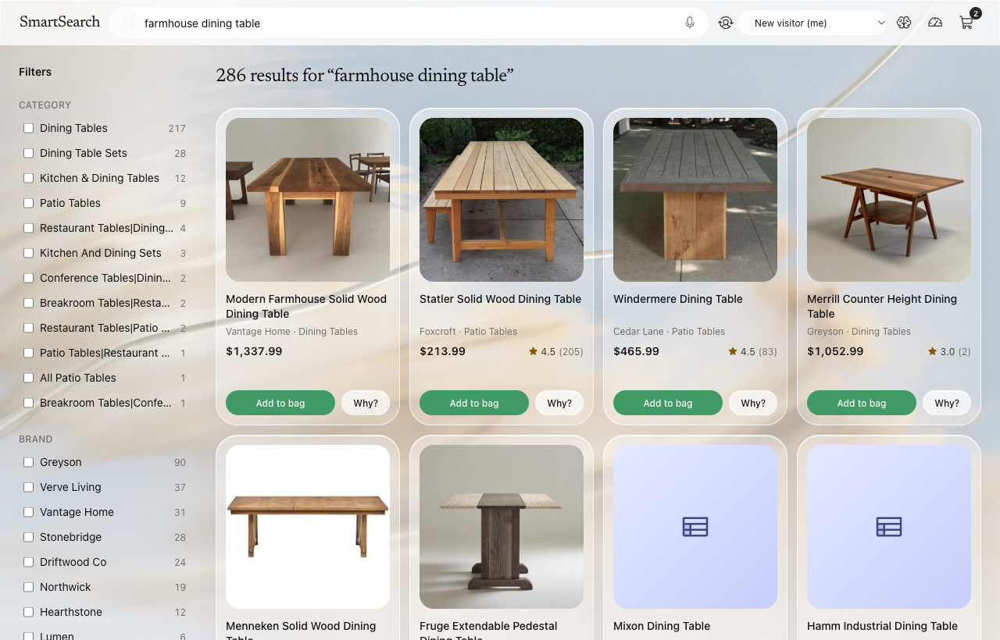
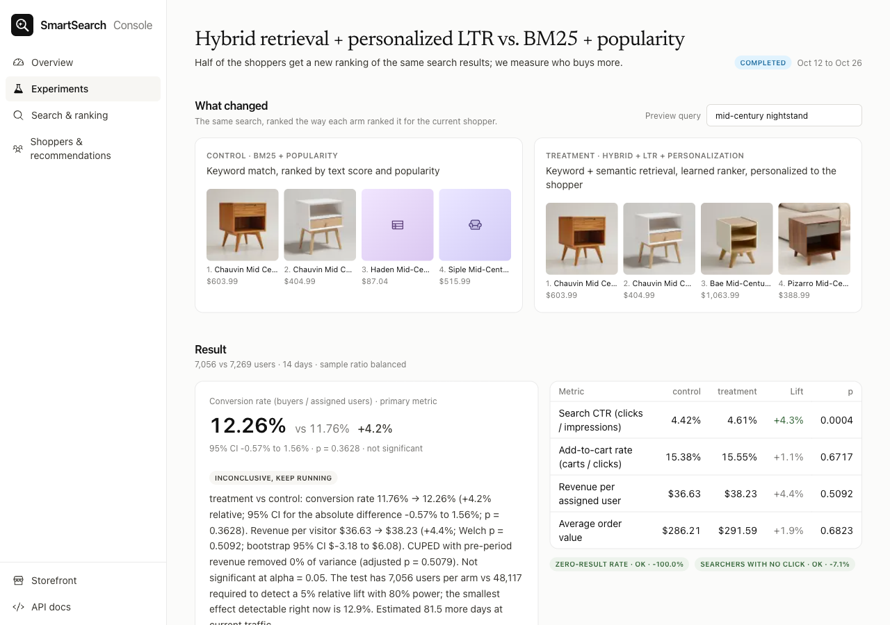

# SmartSearch

**Commerce Intelligence Engine.** A working ecommerce search engine on Wayfair's public WANDS catalog: hybrid
retrieval, a learning-to-rank model, personalization, recommendation rails, an A/B experimentation engine with a
merchant console, and a shopping assistant that can buy. Built as a portfolio project for search and discovery
data-science roles.





Demo video: `docs/demo/smartsearch-demo.mp4` (built by `scripts/demo` (Playwright + ffmpeg), see [docs/upwork-portfolio.md](docs/upwork-portfolio.md) for the portfolio text and the screenshot set in `docs/portfolio/`).

## In 60 seconds

- **Shoppers** search 42,994 furniture and decor products. Keyword and semantic retrieval are fused, a LightGBM ranker orders the candidates, a bounded affinity boost personalizes them. Every result can explain its score.
- **Merchants** get a console with KPIs, search-term analytics, ranking quality and experiments. A console assistant turns a plain-language storefront change into a running A/B test with a sample-size plan and a reject / fail-to-reject verdict.
- **Data.** The catalog, the queries and 233k human relevance grades are real (WANDS). Shopper behaviour is simulated by 20k personas with a position-biased click model calibrated on a real retail clickstream.
- **Headline.** Hybrid retrieval + LambdaRank lifts offline NDCG@10 from 0.688 to 0.722 (5-fold CV). Online, the same ranker shows +4.2% conversion that is not yet significant (p = 0.36) and a significant +4.3% CTR.
- **Stack.** FastAPI, PostgreSQL + pgvector, Redis, LightGBM, bm25s, model2vec, Next.js 15, Claude (Sonnet for the assistant, Haiku for bulk jobs).

## How it works

1. **Retrieve.** BM25 and embedding search run in parallel; reciprocal rank fusion merges them into one candidate list.
2. **Rank.** A LightGBM LambdaRank model trained on 233k human judgments orders the candidates with 23 features. A separate, bounded affinity boost personalizes the order.
3. **Record.** 20k simulated shoppers produce 2.6M search, click, cart and purchase events over 35 days.
4. **Test.** Shoppers are split 50/50 between rankers. The engine computes lift, confidence intervals, p-values, power and guardrails, and issues a verdict.
5. **Decide.** The console shows the funnel, search terms, ranking quality, experiments, segments and revenue opportunities. A contextual bandit learns which ranker to use per request.
6. **Buy.** The assistant adds to the cart and places orders on request. Checkout runs over the Agentic Commerce Protocol, so an external AI agent can buy the same way.
7. **Change and test.** A merchant describes a storefront change to the console assistant; it becomes a running A/B test with a sample-size plan and a hypothesis verdict. Shoppers only ever see their arm.

## What it does

| Surface | Capability |
|---|---|
| Storefront | Natural-language search with price and category intent, suggestions and dictation, facets, "Why this ranking?" explanations, recommendation rails, cart, checkout, shopping assistant |
| Ranking | Hybrid retrieval, LambdaRank re-ranker, affinity boost, exploration slot for cold products, out-of-stock demotion |
| Experiments | Sticky assignment, z / Welch / bootstrap / delta-method tests, CUPED, sample-ratio check, multiple-comparison correction, sequential test, power and MDE, automatic verdict |
| Console | KPIs and funnel, search terms with position-bias curve, offline ranking quality and model registry, experiment reports, segments and cohorts, revenue-at-stake detector. Behind a password |
| Assistant | Claude tool-use loop over the store's own search, recommendation and knowledge-graph APIs; recommends only what a tool returned; adds to cart and checks out on request |
| Decision layer | Typed `choice` / `score` questions (Microsoft-Decision-1 or local fallback) for query intent, assistant routing and a relevance judge scored against human labels |
| Policy learning | Contextual bandit picks the ranking strategy per request; trained off-policy from logged A/B traffic with IPS / SNIPS / doubly-robust evaluation, then A/B tested |
| Knowledge graph | Products, categories, brands, attributes, co-purchase / co-view / semantic edges; communities summarised by Claude; powers the assistant's graph tools and "Goes with it" |
| UI experiments | Describe a storefront change in the console; the assistant drafts both arms, plans the sample size, deploys to half of the shoppers, simulates traffic with a stated effect and reports reject / fail to reject H0 |
| Agentic commerce | Merchant side of the Agentic Commerce Protocol under `/acp`: checkout sessions, product feed, delegated payment. [docs/acp.md](docs/acp.md) |

Method detail: [docs/architecture.md](docs/architecture.md) · [docs/metrics-glossary.md](docs/metrics-glossary.md).

## Results

Offline, WANDS human judgments, 5-fold cross-validation over 479 judged queries, behavioural features zeroed (no leakage possible):

| Strategy | NDCG@10 | MRR | lift vs A (95% CI) |
|---|---|---|---|
| A · BM25 + popularity | 0.688 | 0.884 | baseline |
| B · Hybrid retrieval (RRF) | 0.705 | 0.918 | +0.017 [0.006, 0.029] |
| C · Hybrid + LambdaRank | 0.722 | 0.931 | +0.034 [0.022, 0.045] |

On the 96 test queries never searched during warm-up, BM25 + popularity scores 0.584 against 0.729 for hybrid retrieval.

Online, four simulated experiments (plus any UI test created in the console), each 50/50 by salted hash, every assigned user in the denominator:

| Experiment | Users / arm | Primary: conversion | Other significant moves | Verdict |
|---|---|---|---|---|
| Hybrid + LTR + personalization vs BM25 + popularity | 7.1k / 7.3k | 11.8% → 12.3% (+4.2%, p = 0.36) | CTR +4.3% (p = 0.0004), no-click rate −7.1% (p = 0.02), zero results −100% (p = 0.0009) | keep running (48k per arm for a 5% MDE) |
| A/A sanity check | 7.2k / 7.2k | 12.5% vs 11.5% (p = 0.07) | none at 5% | null, as it should be |
| Exploration slot for cold products | 4.9k / 4.8k | 9.7% → 10.8% (+11%, p = 0.08) | add-to-cart rate +12% (p = 0.001) | keep running |
| Contextual bandit vs fixed ranker | 4.7k / 4.8k | 11.3% → 10.6% (−6.2%, p = 0.27) | CTR −3.6% (p = 0.02) | keep running; off-policy estimate (+4%) not confirmed live |

Every number above is generated by `make report` into [docs/experiment-report.md](docs/experiment-report.md); nothing is
typed by hand. Narrative and caveats: [docs/case-study.md](docs/case-study.md).

## A/B testing methodology

- **Unit and assignment.** The user. `murmur3(salt:user_id) mod 10,000` buckets a shopper once per experiment (sticky, 50/50); the assignment is persisted, and every assigned user stays in the denominator (intention to treat). One running experiment per surface (search, UI).
- **Metrics.** Primary: conversion (purchasers / assigned users). Secondary: CTR, add-to-cart rate, revenue per visitor, average order value. Guardrails: no-click rate, zero-result rate, latency.
- **Tests.** Two-proportion z-test for rates; Welch's t-test plus a bootstrap interval for revenue per visitor; the delta method for ratio metrics such as clicks per search; CUPED with the pre-period covariate for variance reduction; Benjamini–Hochberg across secondary metrics; an mSPRT sequential test so early looks do not inflate false positives; a sample-ratio χ² check before anything else.
- **Power.** Users per arm for the chosen minimum detectable effect at 80 % power and α = 5 %, the MDE reachable with today's traffic, and the days still needed. The headline ranking test needs about 48k users per arm for a 5 % lift.
- **Decision rule.** Ship when the primary metric is significant and positive with no guardrail breach; reject when it is significant and negative or a guardrail breaks; otherwise keep running. An A/A test runs alongside to prove the machinery does not invent lifts.
- **Beyond fixed arms.** A contextual bandit (linear Thompson sampling over 25 context features) chooses the ranking strategy per request. Its propensities are logged, so the policy is first judged off-policy (IPS, SNIPS, doubly robust) and then A/B tested against the fixed ranker.
- **UI tests.** Same engine. Arms carry a storefront configuration instead of a ranking strategy; the console assistant plans the sample size from the live baseline, deploys, and reports reject or fail to reject H0. Simulated traffic and assumed effects are always labelled.

## Ranking

- **Retrieval.** BM25 (bm25s, k1 = 1.2, b = 0.75, stemmed) and semantic search (model2vec `potion-retrieval-32M`, 512-dimensional static embeddings, cosine over an in-memory matrix) each return 200 candidates; reciprocal rank fusion (k = 60) merges them.
- **Features (23).** Retrieval scores and ranks (BM25, title BM25, semantic, fused), class similarity and exact class match, title overlap and length, price, log price, price z-score within the class, price-cap fit, rating, log reviews, popularity, 30-day CTR, cart rate, conversion and impressions, stock, newness.
- **Model.** LightGBM LambdaRank trained on WANDS grades with gains 0 / 1 / 3 (Irrelevant / Partial / Exact), truncation level 20, 15 leaves, learning rate 0.03, L2 = 10, up to 800 rounds with early stopping. Versions live in MLflow; a new model is promoted when its cross-validated NDCG@10 is at least as good as the champion's.
- **Personalization.** An additive affinity boost bounded to [−1, 1] (brand, class, style, material, colour weights plus a price-fit term) built from the shopper's clicks, carts and purchases and cached for two minutes. It sits on top of the ranker score so it can be switched off and tested on its own; cold shoppers get zero.
- **Exploration and business rules.** A Thompson-sampling slot at position 5 for in-stock products with fewer than 50 impressions, drawn from ranks 6 to 60; out-of-stock items are demoted.
- **Evaluation.** 5-fold cross-validation over 479 judged queries with behavioural features frozen at the end of warm-up (zeroed for the headline), reporting NDCG@10 and @20, MRR, Precision@10, Recall@50 and MAP@10 with bootstrap intervals and a per-query win rate. Every result exposes its feature contributions in the storefront.

## Recommendations

- **Similar items.** Nearest neighbours in the same embedding space, in stock only.
- **Bought together.** Item-item similarity from session co-occurrence weighted click 1 / cart 2 / purchase 3, cosine-normalised, top 20 neighbours with minimum support 2; co-purchase first, co-occurrence as fallback.
- **Goes with it.** Complements from the product knowledge graph (co-purchase, co-view and category-adjacency edges, Louvain communities), falling back to co-purchase.
- **Picked for you.** Co-occurrence neighbours of the shopper's 10 most recent items plus content neighbours of the last 5 (weight 0.5), scored as normalised base + 0.6 × affinity boost + 0.1 × popularity; purchased items are excluded; a visitor without history sees Trending instead.
- **Trending and New arrivals.** Popularity over the last 30 days, and the same restricted to new products.
- **Display and measurement.** Every rail filters out-of-stock items and shows products with a photo first among its top candidates (a display rule, scores unchanged). Impressions and clicks are logged per rail, so the console reports CTR and attributed conversion by rail. Diversity controls (MMR, brand caps) are the next step.

## Questions a recruiter may ask

**What is the difference between search, ranking and personalization here?**
Search retrieves candidates: BM25 over titles and semantic nearest neighbours over embeddings, fused by reciprocal rank
fusion. Ranking orders them: a LightGBM LambdaRank model with 23 features. Personalization adjusts the order per
shopper: a bounded boost from the shopper's brand, category, style, material, colour and price history. Each layer is
its own strategy, so each can be A/B tested alone.

**Why both BM25 and embeddings?**
They fail differently. BM25 misses paraphrases ("couch" for "sofa"); embeddings miss exact model names and
over-generalise. Fusing them lifted NDCG@10 by +0.017 (95% CI 0.006 to 0.029). On 96 queries never seen in warm-up,
BM25 + popularity scored 0.584 against 0.729 for the fused list.

**What does learning to rank add?**
Hand-tuned weights stop working past a few features. LambdaRank optimises NDCG directly, by query group, from the
WANDS grades (Exact counts three times a Partial in the gain). The 23 features cover retrieval scores and ranks, class
match, title overlap, price and its z-score within the class, rating, reviews, stock, popularity and 30-day CTR, cart
and conversion rates. It adds about +0.016 NDCG@10 over fused retrieval, and every result exposes its feature
contributions in the "Why this ranking?" drawer.

**Why NDCG@10, and what else do you report?**
Position matters and grades are graded, not binary; NDCG@10 captures both. The report also gives NDCG@20, MRR,
Precision@10, Recall@50 and MAP@10 with bootstrap confidence intervals, and a per-query win rate so a lift is not
carried by a handful of queries.

**How did you avoid leakage when evaluating the ranker?**
Behavioural features (CTR, cart rate, conversion, impressions) are frozen at the end of the warm-up period before
training and evaluation, and the headline comparison zeroes them entirely. Before that fix the control's NDCG moved
from 0.58 to 0.71 on one split, purely from leaked behaviour. The headline is 5-fold cross-validation, not one split.

**How does personalization work, and what about a new shopper?**
A profile of brand, category, style, material and colour affinities plus a price-fit term is built from the shopper's
clicks, carts and purchases. It is an additive boost bounded to [-1, 1] on top of the ranker score, not a ranker
feature, so it can be switched off and tested alone. A new shopper has an empty profile and a zero boost, and the
"Picked for you" rail falls back to trending items.

**How do you handle cold-start products?**
A Thompson-sampling exploration slot. Position 5 goes to an in-stock product with fewer than 50 impressions, drawn by
Beta(1 + clicks, 1 + impressions − clicks) from ranks 6 to 60. In its A/B test the slot raised add-to-cart rate by 12%
(p = 0.001); conversion moved +11% but is not significant (p = 0.08).

**How do the recommendation rails work, and how do you avoid repeating products?**
Similar items use embedding neighbours; Bought together uses co-purchase item-item similarity; Goes with it uses
knowledge-graph complements with a co-purchase fallback; Picked for you blends co-occurrence neighbours of recent
items, content neighbours and the affinity boost. Repetition is only addressed by the exploration slot today; brand
caps and MMR re-ranking are the next step. Rails also show products with a photo first among their top candidates,
a display rule that does not change scores.

**How do you know a new ranker is better online?**
Sticky 50/50 assignment by salted hash, every assigned user in the denominator. A sample-ratio check first (χ²
p = 0.08 here). Conversion by two-proportion z-test, revenue per visitor by Welch's t-test and bootstrap, ratio metrics
by the delta method, CUPED on pre-period revenue, Benjamini–Hochberg across metrics, guardrails on latency, no-click
rate and zero results, then power and MDE. The engine issues ship, keep running or reject.

**Your headline test is not significant. What do you conclude?**
Nothing yet about conversion: +4.2% at p = 0.36 with 7k users per arm, when a 5% minimum detectable effect needs
about 48k per arm. The secondary metrics did move: CTR +4.3% (p = 0.0004) and no-click rate −7.1% (p = 0.02). The
honest verdict is "keep running". The A/A test next to it (p = 0.07, nothing significant at 5%) shows the machinery
does not invent lifts.

**Why a bandit on top of A/B testing?**
An A/B test picks one ranker for everyone; a contextual bandit (linear Thompson sampling, 25 context dimensions) can
pick per request. It was trained off-policy from the logged A/B traffic with recorded propensities. Off-policy
evaluation said +4% (SNIPS; plain IPS collapsed from variance). Live, the bandit showed −6.2% conversion (p = 0.27) and
−3.6% CTR (p = 0.02). The estimate did not confirm, which is why it is tested live.

**Relevant results but low conversion. What would you do?**
Split the funnel: searches → clicks → carts → purchases, by segment and by query. Low CTR points at ranking or
presentation; clicks without carts at price, stock or product content; carts without purchases at checkout. The
console does this with the funnel, the search-term table, the position-bias curve and a revenue-at-stake detector
that ranks the leaks. Fix the largest one, then A/B test the fix.

**Can a merchant run a test without engineers?**
Yes. The console assistant drafts both arms of a storefront change (button label, style, icon, ratings, badges, hero
text, banner), plans the sample size from the live baseline, deploys to half of the shoppers and reports reject or
fail to reject H0. Until real traffic arrives it reads on simulated shoppers with a stated assumed effect and says
when the result is underpowered.

**How does an AI agent buy from the store?**
Through the Agentic Commerce Protocol: checkout sessions, a product feed and delegated payment tokens under `/acp`.
The store's own cart and assistant check out through the same endpoints, so an external agent gets the same path.

**What is real and what is simulated?**
Real: the catalog, the queries and 233k human relevance grades (WANDS), and funnel ratios from the Retailrocket
clickstream. Simulated: all shopper behaviour (20k personas, 2.6M events over 35 days), prices, brands and stock.
The A/B results validate the pipeline and the statistics, not a business case.

Longer answers: [docs/interview-faq.md](docs/interview-faq.md).

## Quickstart

Requirements: Docker, Python 3.12 with [uv](https://docs.astral.sh/uv/), Node 20+.

```sh
cp .env.example .env
make setup        # ~10 min: infra, deps, migrations, WANDS download, embeddings, warm-up, training, A/B simulation, marts, eval, report
make photos       # optional, once: a representative photo per product from the Amazon Berkeley Objects dataset (~3.3 GB download)
make api          # http://localhost:8000/docs
make web          # http://localhost:3000  ·  console http://localhost:3000/admin  ·  MLflow http://localhost:5001
```

The console asks for the keyword in `ADMIN_PASSWORD` (`frontend/.env.local`). Optional keys in `.env`:
`ANTHROPIC_API_KEY` enables the assistants and graph summaries; `OPENROUTER_API_KEY` or a Foundry endpoint
(`DECISION1_*`) switches the decision layer to Microsoft-Decision-1; Kaggle credentials enable `make retailrocket`;
`HF_API_KEY_ID` + `HF_API_KEY_SECRET` ([Higgsfield](https://cloud.higgsfield.ai)) enable `make images`.

## Architecture

```
Storefront / Console (Next.js 15)  ── console behind a password; admin calls proxied server-side with the API key
        │
FastAPI /api/v1 ── search · recommendations · events · experiments · analytics · agent   ·   /acp ── agentic checkout
        │
In-process ML runtime: bm25s · model2vec · RRF · LightGBM LambdaRank · affinity boost · LinTS bandit · item-item CF · knowledge graph
Decision layer: Microsoft-Decision-1 (intent, routing, relevance judge) with local fallbacks
        │
PostgreSQL + pgvector (catalog, events, marts) · Redis (profiles) · MLflow (model registry)
        ▲
Simulator: 20k personas, position-biased click model, Retailrocket-calibrated funnel, same ranking code as the API
```

Details: [docs/architecture.md](docs/architecture.md) · [docs/metrics-glossary.md](docs/metrics-glossary.md) ·
[docs/deploy.md](docs/deploy.md) · decisions in [docs/adr](docs/adr).

## Data and honesty

- **Real:** 42,994 products, 480 queries and 233k graded judgments ([WANDS](https://github.com/wayfair/WANDS)); Retailrocket funnel ratios. Raw data is downloaded by scripts and never committed.
- **Synthetic:** prices, brands, stock and "new" flags (flagged in `attributes._synthetic`); all shopper behaviour.
- **Photos:** 166 generated from the catalog text (Higgsfield, provenance in `frontend/public/img/products/manifest.json`) and 17,396 representative photos from the Amazon Berkeley Objects dataset, matched to each product by text similarity. Both kinds are labelled on the product page; the rest show a category tile. Rails show products with a photo first among their top candidates.
- Behavioural features are frozen at the end of warm-up for training and evaluation. The A/B results validate the pipeline and the statistics, not a business case.
- **Console-created UI tests** read on simulated traffic with an assumed effect the merchant states; the console labels them as such until real visitors arrive.

## Repository

```
backend/   FastAPI app (app/), data + ML pipeline (scripts/), Alembic, tests
frontend/  Next.js storefront (/) and console (/admin)
docs/      architecture, case study, interview FAQ, ACP, generated experiment report, glossary, deploy, ADRs
```

`make help` lists every target. `make test` runs the backend suite (statistics verified against scipy/statsmodels,
deterministic assignment, NDCG hand checks). CI runs lint, migrations, tests and the frontend build.

## License and attribution

Code: MIT. WANDS is © Wayfair, used under its repository license. Retailrocket is CC BY-NC-SA 4.0. Representative
product photos come from the [Amazon Berkeley Objects](https://amazon-berkeley-objects.s3.amazonaws.com/index.html)
dataset (CC BY 4.0, © Amazon.com); each photo shows a similar Amazon listing, not the catalog item itself.
