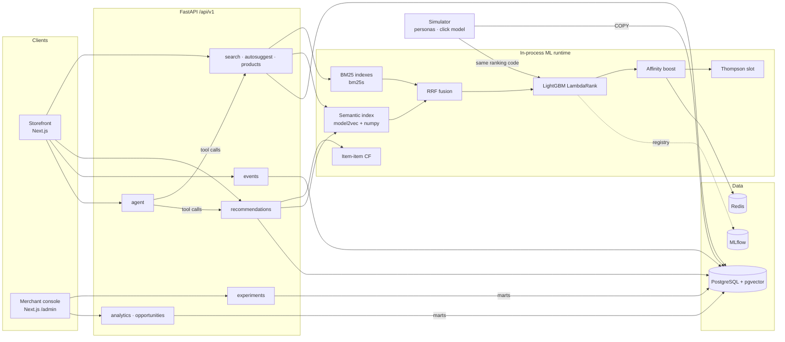

# Architecture

SmartSearch is a small, end-to-end ecommerce product-discovery platform: a shopper storefront and a merchant
console on top of hybrid retrieval, a learning-to-rank model, per-shopper personalization, recommendations, a
behavioral event log and an A/B experimentation engine with a real statistics layer.



## Request path for a search

1. **Assignment.** `experiment_service.expose()` hashes `murmur3(salt:user_id) mod 10,000` for the running experiment
   on the `search` surface. Enrolled users get a variant (sticky by construction); the assignment is persisted.
2. **Query understanding.** `ml/query.py` normalises text, parses price constraints ("under $300"), embeds the query;
   `ClassIndex` maps it softly to catalog categories (cosine to class-name embeddings).
3. **Retrieval.** BM25 (title + class + attributes + brand) and semantic nearest neighbours each return 200
   candidates; `rrf_fuse` unions them with reciprocal-rank fusion.
4. **Features.** `ranking/features.py` builds 23 query-document features: retrieval scores and ranks, title-only BM25,
   category intent (soft + exact), title overlap, price/rating/reviews, rolling behavioral stats.
5. **Strategy.** `control_bm25_pop` (keyword + popularity), `hybrid_rrf`, `hybrid_ltr`, or `hybrid_ltr_personalized`
   (adds an explicit affinity term from the shopper's history and an optional Thompson-sampling exploration slot).
6. **Logging.** One `search` event plus one `impression` per shown product, stamped with experiment key, variant,
   strategy and model version. Clicks, carts and purchases are logged by the client SDK (`lib/tracking.ts`).

## Personalization is a boost, not a feature

The ranker is trained on WANDS editorial labels, which carry no user signal; user-affinity features would be
constant zero in training. Personalization is therefore an inspectable additive term (`strategies.affinity_boost`)
shown separately from the model's SHAP-style contributions in the "Why this ranking?" drawer. A click-trained
personalizer with inverse-propensity weighting is the natural next step; position is logged for exactly that.

## Decision layer (Microsoft-Decision-1)

`app/decision/` wraps Microsoft's decision-scoring model: typed questions (`noul` / `choice` / `score`) over a text
or JSON state, answered with calibrated probabilities instead of prose. Backends: Foundry
(`/providers/microsoft/v1/systemone`), OpenRouter (`/api/alpha/decisions`), or `local`, where every decision point
supplies its own approximation so nothing depends on credentials. Three decision points:

| Decision | Type | Where it acts | Local fallback |
|---|---|---|---|
| Query intent (which category?) | `choice` over top-6 embedding candidates + other | search: overrides the soft category intent when p ≥ 0.5; logged in the search event | softmax of embedding similarities |
| Assistant routing | `choice`: chat / direct_search / clarify / assistant | agent: greetings and thanks get a short reply and no search; plain product queries skip the LLM loop | small-talk regex + keyword heuristic |
| Relevance judge | `score`: Irrelevant / Partial / Exact per product | agent: drops confident misses from the final picks; offline: graded against WANDS human labels (`make decisions`) | semantic-similarity mapping |

The judge evaluation (accuracy, MAE of the expected grade, Spearman, confusion matrix) is the honest check that a
decision model is good enough to act on; the console shows it next to the ranking metrics.

## Ranking-policy bandit (reinforcement learning done the way search teams do it)

RLHF needs human preference labels and tunes a language model; the ranking decision here is a one-step choice with
a logged reward, which is a contextual-bandit problem. `app/bandit/`:

- **Context** (`context.py`): intent group, price constraint, query length, shopper history bucket, segment, device
  (one-hot, 25 dims). **Actions**: the ranking strategies, plus the exploration-slot variant.
- **Policy** (`policy.py`): linear Thompson sampling (ridge-Gaussian posterior per action); the logged propensity is
  the Monte-Carlo probability of the chosen arm, so later off-policy analysis is possible.
- **Off-policy evaluation** (`ope.py`): IPS, self-normalised IPS and doubly-robust estimates with bootstrap CIs and
  effective sample size, computed on a held-out half of the logs with reward models fit on the other half.
- **Lifecycle**: `train_bandit.py` builds (context, action, propensity, reward) tuples from the A/B phases (known 50/50
  propensities), fits the policy offline and writes the OPE report; the policy is then **A/B tested** against the fixed
  treatment (experiment `bandit_policy_v1`, simulation days 28-34, learning online from purchases) instead of being
  trusted on OPE alone. Live traffic can select it as the `bandit` strategy of an experiment variant.

## Product knowledge graph (GraphRAG for the assistant)

`app/graph/kg.py` + `scripts/build_graph.py`: a NetworkX graph with product, category, brand and attribute-value
nodes; behavioural edges (co-purchase, co-view) and semantic edges (top-5 embedding neighbours); Louvain communities
over the product subgraph, each summarised by Claude (name, what they have in common, who buys them) and embedded
for topic lookup. The assistant gets two graph tools, `graph_topic` (themed exploration before searching) and
`graph_complements` (bundles, "what else do I need"), and the product page gets a "Goes with it" rail.

## Product imagery

WANDS ships no photos. Two sources fill the gap, both labelled on the product page, and the rails show products
with a photo first among their top candidates (`recs_service._photo_first`, a display rule applied after scoring).

**Representative photos** (`scripts/fetch_product_photos.py`, `make photos`): the Amazon Berkeley Objects dataset
(CC BY 4.0, 147k listings with catalog photos) is downloaded once; every ABO item with an English name and a home-goods
product type is embedded as `name . product type` with the same model2vec model the search uses, every WANDS product
as `name . class`, and each product takes the photo of its nearest ABO item by cosine similarity, best-first, with a
similarity floor (0.5; at 0.45 about a quarter of the weakest matches were the wrong product type) and at most
three products per photo, items handing out their least-used of up to four photos, so grids stay varied. Matched 256 px images are
extracted straight from the tar to `data/processed/photos/<product_id>.jpg`, served by the API at `/static/photos`
and rewritten to `/img/photos/*` on the web origin; `photo_matches.parquet` records item, score and text. Generated
photos keep precedence.

**Generated photos** (`make images`): `app/imagery.py` + `scripts/generate_images.py` (`make images`) pick the products shoppers see
first (home rails, top results of the suggested searches and of the assistant's starter prompts, most-shown), build a
prompt per product from its name, class, category path and parsed attributes, and call the Higgsfield REST API
(`POST /alibaba/qwen-image-3/text-to-image` by default, SOUL and Z-Image selectable; `Authorization: Key <id>:<secret>`,
polled at `/requests/{id}/status`). Results are
stored as 768px webp under `frontend/public/img/products/`, every prompt, model and request id is recorded in
`manifest.json`, and `products.image_url` is set so the API serves the path. Without credentials the script prints the
prompts; the storefront falls back to deterministic category tiles and labels every generated image as such.

## Console access and caching

The console is behind one shared keyword: `frontend/middleware.ts` verifies a signed 12-hour cookie (HMAC over the
expiry, keyed by `ADMIN_PASSWORD`) and redirects to `/admin/login`. Console data requests go to the same-origin
proxy `app/api/admin/[...path]`, which checks the cookie and forwards to the API with the server-side `ADMIN_API_KEY`;
the browser never holds the key. On the API, `core/cache.py` memoises per-product rails (10 min), global rails (60 s)
and console analyses (60 s, cleared on status changes and simulated traffic); responses carry `Cache-Control` and are
gzipped. The web client persists product pages and global rails in `localStorage` for an hour and prefetches a product
page when its card is hovered.

## UI experiments from the console

Experiments on surface `ui` carry a `UiConfig` per arm (button label/style/icon, ratings, badges, hero text, banner).
The storefront calls `POST /experiments/expose` once per shopper, which assigns and persists the arm and returns its
config (`lib/ui-config.tsx`); product cards, the product page and the hero read it. `POST /experiments/draft` is the
console assistant (Claude Haiku, rule-based fallback): tools `propose_ui_experiment`, `plan_sample_size`,
`launch_experiment`, `simulate_traffic`, `read_results`. `POST /experiments/{key}/simulate` runs the regular
simulator with one experiment and fresh shoppers; each arm's `effect` (assumed relative lifts) multiplies the click,
cart and purchase probabilities in `simulation/click_model.py`. Results come from the same analysis engine; the
console labels simulated traffic and states the assumed effect.

## Agentic commerce (ACP)

`app/api/v1/acp.py` exposes the merchant side of the Agentic Checkout Specification 2025-09-29 under `/acp`: checkout
sessions (create, update, complete, cancel), a JSON product feed and a mock delegated-payment endpoint. Pricing and
state rules live in pure functions in `app/services/acp_service.py` (unit-tested); completion reuses the regular
purchase path, so agent orders appear in the same marts and experiments. The cart page and the assistant's
`start_checkout` / `complete_checkout` tools are clients of these endpoints. Details: [acp.md](acp.md).

## Behavioral data model

`events` is append-only without foreign keys (bulk COPY, anonymous visitors). Dashboards read materialized marts
built by `analytics/sql/*.sql`:

| Mart | Grain | Used by |
|---|---|---|
| `product_stats` | product | ranking features (Bayesian-smoothed rates, popularity) |
| `mart_funnel_daily` | day | overview KPIs |
| `mart_search_terms_daily` | day × query | search analytics, opportunity detector |
| `mart_product_daily` | day × product | product performance, opportunity detector |
| `mart_experiment_user` | experiment × user | every experiment metric (denominator = all assigned users) |
| `mart_experiment_daily` | experiment × variant × day | cumulative lift charts |
| `mart_cohort_retention` | cohort week × week | retention heatmap |

## Experimentation engine

`experiments/stats.py`: pure functions tested against scipy/statsmodels - two-proportion z-test with Newcombe CI,
Welch t-test, percentile bootstrap, delta-method tests for ratio metrics (CTR, AOV), CUPED, SRM chi-square,
Benjamini-Hochberg, mSPRT always-valid p-values. `analysis.py` computes metrics from `mart_experiment_user`,
`power.py` gives required sample size / MDE / achieved power, `decision.py` turns results into
ship / reject / keep-running / investigate with a plain-language narrative.

## Simulator

`simulation/` draws 20,000 shoppers from six personas with latent brand, style, category and price tastes. Each
search goes through the real ranking code; a position-biased click model (examination decays with rank) uses the
WANDS grade as relevance (category match for unjudged pairs), then cart and purchase probabilities calibrated to
Retailrocket's funnel. Days 0-6: warm-up under the control ranker on train/val queries only, so behavioral features
never see test-query clicks. Days 7-20: ranking A/B test plus a layered A/A test. Days 21-27: treatment shipped,
exploration-slot test.

## Repository map

```
backend/app/
  api/v1/          routers: search, products, recommendations, events, experiments, analytics, users, agent
  services/        runtime (ML singletons), search, recs, events, experiments, analytics, opportunities, agent
  ml/              retrieval (bm25, semantic, hybrid), ranking (features, ltr, strategies, explain), recs, personalization, eval
  experiments/     assignment, stats, power, analysis, decision
  simulation/      personas, click_model, simulator, reset
  analytics/       sql marts, marts runner, as-of snapshot
backend/scripts/   download_wands, build_catalog, embed_catalog, simulate, train_ranker, offline_eval,
                   build_item_similarity, refresh_marts, export_report, download/eval_retailrocket, enrich_attributes,
                   generate_images
frontend/app/      (shop) storefront · admin console · assistant
```
